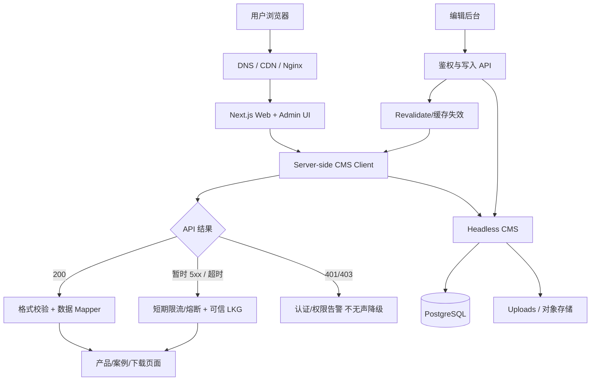

# 可复用的网站 + CMS + Agent 工程设计蓝图（通用模板）

**用途**：将 dBsource 的成熟经验迁移到其它商业网站。此文档是“设计规范 + 示例代码”，**不是把当前 dBsource 项目直接重构或部署的指令**。示例代码放在 `templates/reusable/`，与实际业务文件隔离。先测，再按项目调整。

## 一、适用边界

目标系统：小型/中型企业内容官网、产品目录、案例、下载中心、后台运营管理；技术可采用 Next.js + Headless CMS（Strapi、Directus、Payload、Sanity 等）+ PostgreSQL + Nginx + PM2/Docker。跨项目共性：产品数据/媒体、语言、分类动态管理、后台 CRUD、缓存回退、发布检查、可观测性和安全。

**不适合直接复用**：对数据库事务要求很强的订单/支付、电商库存、强监管业务；需单独设计审计、权限、资金一致性和容灾。

## 二、目标架构



### 2.1 目录约定（新项目建议）

```text
new-project/
  AGENTS.md
  app/
    (site)/products/
    (site)/cases/
    (site)/downloads/
    admin/
    api/admin/
    api/health/
  components/
    ui/
    admin/
    product/
  server/
    cms/client.ts            # 唯一 CMS 入口，API/timeout/token
    cms/mappers.ts           # 网络 DTO -> 域模型
    cms/repository.ts        # 数据访问/查询/缓存
    cms/revalidation.ts      # 后台保存后失效
    auth/
  domain/
    product.ts
    series.ts
    spec.ts
  cms/
    src/api/
    config/database.ts
  scripts/ops/
    read-only-diagnostics.sh
  tests/
    unit/
    integration/
    smoke/
  docs/
    ARCHITECTURE.md
    OPERATIONS.md
    INCIDENTS.md
    RELEASE_CHECKLIST.md
  templates/reusable/       # 本包示例代码，不自动作为生产运行文件
```

**规则**：UI 不能自己遍历数据库/拼接 CMS API；后台保存只通过受保护的服务端 API；CMS Model/DTO 和前端 Domain Model 分离；只允许明确列表/Schema 的字段写入。每一步的错误必须可观测。

## 三、跨项目核心代码模型

### 3.1 CMS 客户端边界

`templates/reusable/cms-client.mjs` 提供可直接执行的通用只读客户端：

- `createCmsClient({ baseUrl, token, fetchImpl, timeoutMs, ttlMs, staleMaxAgeMs })`
- 支持统一超时、HTTP 状态判断、同一请求并发去重、短时内存缓存、临时故障时最多 `staleMaxAgeMs` 的 last-known-good 退化。
- **401/403 不走静默缓存兜底**，直接抛错误，让工程师知道认证配置需要修。
- 不返回真实凭据，不输出 token；代码中无 dBsource 特有路径或业务规则。
- 缓存只存在本 Node 进程内；PM2 重启即丢失。生产中如需要重启后仍可用，应在此抽象上另外加文件/Redis LKG，并明确最大陈旧时间、文件原子写入与访问权限。
- **不自动重试**：错误重试如果没有限流/指数退避，会在数据库连接池故障时造成请求雪崩。调用层应设计有上限的重试策略和单飞、熔断。

```js
import { createCmsClient } from './templates/reusable/cms-client.mjs';
const cms = createCmsClient({
  baseUrl: process.env.CMS_URL ?? 'http://127.0.0.1:1337',
  token: process.env.STRAPI_API_TOKEN,
  timeoutMs: 4000,
  ttlMs: 30_000,
  staleMaxAgeMs: 5 * 60_000,
});
const {data, source, ageMs} = await cms.getCollection('/products?pagination[pageSize]=20');
// source: live / memory-cache / stale
```

仅在服务端运行，不向浏览器发送 Token。使用方需要在 API/Server Components 对 `source === 'stale'` 做监控和必要的用户提示。

### 3.2 业务产品模型（跨项目 TS 参考设计）

```ts
type MediaAsset = { id: string; originalUrl: string; mime?: string; width?: number; height?: number };
type SeriesConfig = {
  slug: string;
  zhName: string;
  enName: string;
  visible: boolean;
  sortOrder: number;
};
type Product = {
  id: string;
  model: string;
  seriesSlug: string;
  title: { zh: string; en: string };
  cover?: MediaAsset;
  gallery: MediaAsset[];
  specs: { labelZh: string; valueZh: string; labelEn: string; valueEn: string }[];
  technicalSpecImage?: MediaAsset; // 独立媒体
};
```

建议所有动态类别管理：CMS 为 series 的 source of truth；产品只引用 series stable slug/ID；系统默认项只是启动数据，不得作为永久硬编码白名单。删除时若关联产品不为 0，则禁止硬删除，允许隐藏。URL 使用稳定 slug，UI 语言切换不影响过滤。后台表单与前台使用同一 mapper/schema/查询语义。

### 3.3 产品技术规格的状态设计

**四象限**：表格有/无 × 图片有/无；保存空参数时必须持久化空值而非“字段省略”，否则系统无法区分用户主动删空和旧数据。参数编辑器的本地状态、后台 API、CMS 字段和前台展示全部遵守同一约束。

```ts
const rows = draft.rows.filter((row) =>
  [row.labelZh,row.valueZh,row.labelEn,row.valueEn].some((x) => x.trim() !== '')
);
const payload = {
  specsZh: rows.length ? serializeZh(rows) : '',
  specsEn: rows.length ? serializeEn(rows) : '',
  technicalSpecImage: draft.technicalSpecImageId ?? null,
};
```

`serializeZh/En` 是业务模块独立实现的配对序列化函数，不是凭空存在的库函数。生产应有回归测试：删最后一行 → 保存 → 重新获取 → 仍 0 行。

### 3.4 原图/下载设计

- 图片列表用自适应展示，原图/下载明确采用 CMS 媒体的原始 URL，不取 thumbnail 变体。
- `width:100%` / `height:auto`，必要时按最大宽度显示，绝不拉伸产品实图或截断表格图片。
- `<a download>` 在跨域 URL 常被浏览器忽略；要保证直下，使用受权限保护的**同源**下载 API、可信媒体 ID 白名单、文件类型/大小限制、`Content-Disposition: attachment`、重定向/SSRF 防护。
- 不允许页面提供任意第三方 URL 参数让服务器代理下载，这会引入 SSRF 风险。

## 四、缓存、连接池和高可用

1. **请求单飞**：相同 URL 的同时请求共用一个 Promise；避免一次产品页渲染触发多次完全相同 CMS 查询。
2. **请求限时**：5 秒级超时只用于提醒上游慢；Strapi/Knex 卡 60 秒需要查真正 DB 原因。
3. **区分失败类型**：401/403 代表授权，404 代表资源，429 代表限流，5xx/网络超时可能暂时性；错误分类决定告警和降级。
4. **受控缓存**：按条目设置 TTL 和最长陈旧时间；若系统高风险/高度实时，不允许陈旧显示。
5. **断路器（可选）**：连续失败超过阈值后短暂停止直连，防止打满 DB；但必须配合半开探测和状态监控；不能因为熔断永久隐藏数据故障。
6. **数据库查询**：用索引、分页、只拉所需字段和 populate；防止一个页面引起几百个媒体/产品请求。
7. **DB Pool**：数据库连接池最大值需要根据 CPU/内存/Postgres `max_connections`、其它服务预留和并发需求设计；没有测量不得盲目将 `DATABASE_POOL_MAX` 调大。
8. **服务健康**：存活检查（进程/端口）与就绪检查（真实受限查询）分开；当 CMS 500 时前端 200 不代表系统整体健康。
9. **版本化发布**：在候选 release 构建成功并经健康检查后才切换 PM2；前一 release 保留，数据库迁移须有独立回滚/备份。

## 五、Agent 自动化执行协议（复制到别的项目）

```text
身份：你是本项目维护 Agent。先读 AGENTS.md、docs/ARCHITECTURE.md、docs/OPERATIONS.md。
规则：一次只修改一个逻辑目标；先审计源码与生产约束。没有确认的事实标注「待核实」。
执行：列出涉及层（schema / API / Mapper / UI / 缓存 / 测试）；只改最小文件集合。
质量：TypeScript → unit → build → API 测试 → 浏览器验收 → 部署预检。
禁令：不得自行覆盖线上数据、重建数据库、强制重置 Git、打印密钥。构建失败不得重启。
交付：说明变更文件、验证结果、风险、回滚方式、下一步建议，等待确认再继续。
```

### 5.1 推荐最小单元任务格式

```md
# TASK-ID
目标：一句话
用户可见验收：哪些画面/URL/数据变化
限制：不改什么
审计：真实代码路径、调用链、当前版本
实现：文件与原因
验证：命令和结果
上线：审批、备份、灰度、回滚
状态：待开发 / 本地通过 / 线上验证 / 完成
```

## 六、可复用脚本与验证

本包含：

```text
templates/reusable/cms-client.mjs
  Node.js 18+ ESM，只读 CMS 客户端示例
templates/reusable/cms-client.test.mjs
  不联网单元测试：200、缓存、请求去重、401 不缓存、超时可降级
scripts/ops/read-only-diagnostics.sh
  Linux 脚本：PM2、端口、Nginx、本机 HTTP 只读体检
templates/reusable/ci-next-strapi.example.yml
  GitHub Actions PR 构建检查示例，不部署、不使用生产密钥
```

在支持 Node.js 的环境运行：

```bash
node --test templates/reusable/cms-client.test.mjs
node --check templates/reusable/cms-client.mjs
bash -n scripts/ops/read-only-diagnostics.sh
```

**重要**：样例是可移植的架构参考，不要求直接替换 dBsource 已有 `lib/strapi-client.ts` / LKG 机制；先审计再融合，避免同时存在双重缓存和不同鉴权逻辑。

## 七、复制到其他项目的 SOP

1. 新建 Repo，复制 `AGENTS.md` 通用规则（替换项目特定路径）、`docs/*` 模板与 `templates/reusable`；不拷贝 dBsource 的产品数据/商标/Token。
2. 制定领域模型和 CMS schema；先有业务验收，再写表单和页面。
3. 实现 Server CMS Client + DTO Mapper + 错误/超时语义；测试匿名与 Token API 两套访问策略。
4. 实现后台保存与 invalidate；确保修改可逆、可审计。
5. 建 CI：lint、tsc、unit、build；发布候选环境先验证健康与数据，再切换服务。
6. 备份演练 + 事故告警；数据库和媒体不同步的风险提前规划。
7. 增加 `docs/INCIDENTS.md` 与 `docs/RELEASES.md`，以后每个修复都有可追溯记录。
